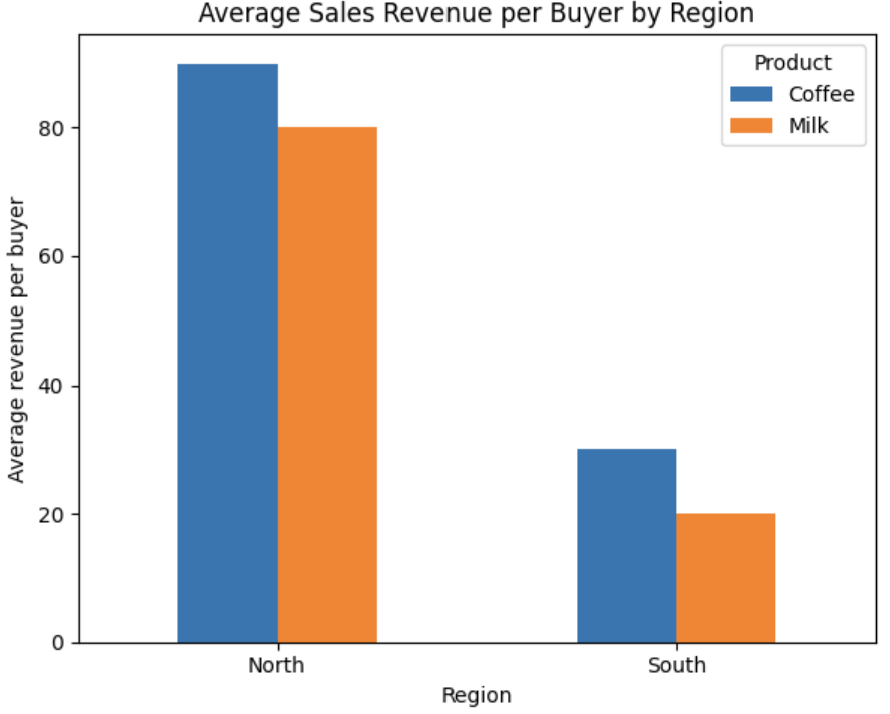
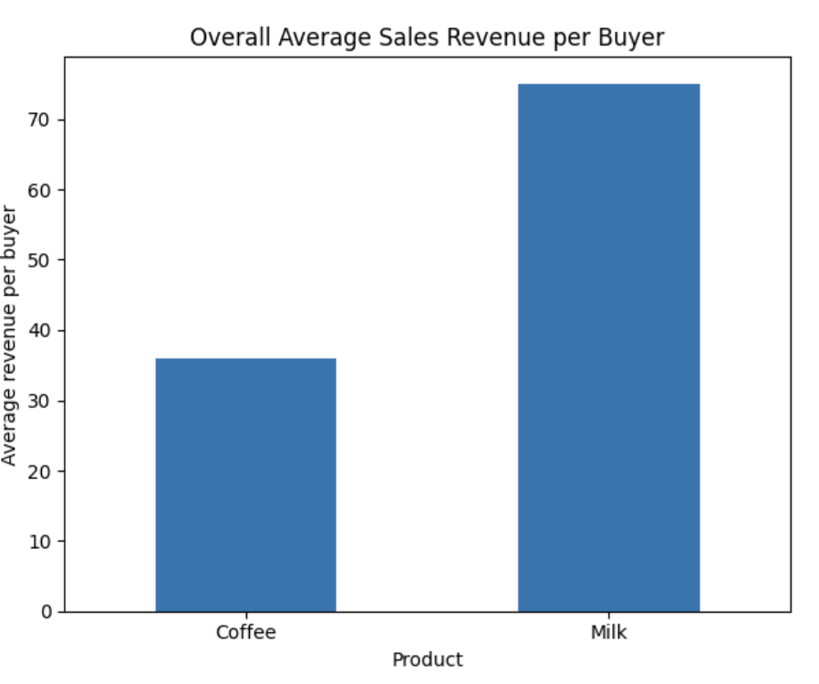
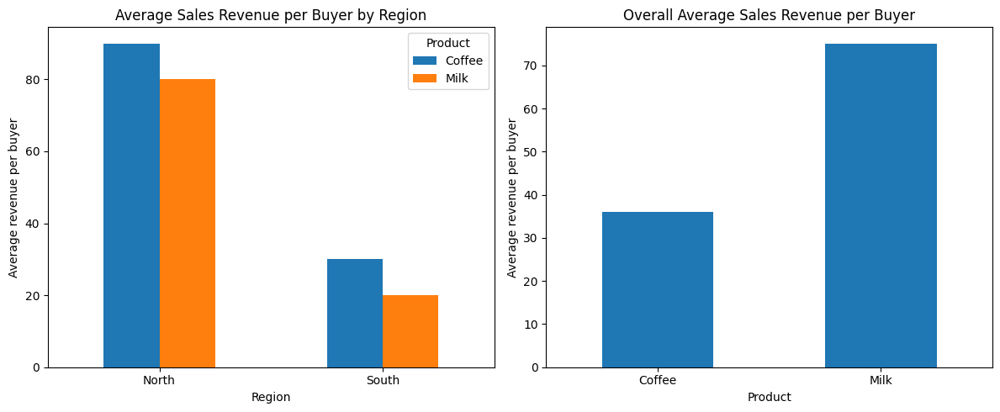

# 📊 Simpson's Paradox: A Sales Analysis

**Can a product perform better in every region but worse overall?**

This project demonstrates **Simpson's paradox** using a synthetic sales dataset created with Python. It explores how differences in regional buyer distributions can reverse an overall comparison.


---

## ✨ Project Overview

The objective is to understand how aggregated data can tell a different story from subgroup-level results.

We compare the average sales revenue per buyer for two products:

- ☕ Coffee
- 🥛 Milk

The analysis examines performance in two regions, North and South, and then combines the results.

**Research question:** Can the overall winner differ from the winner within each region?

## 🗂️ Dataset

The dataset is synthetic and contains four product-region groups.

| Region | Product | Buyers | Average Revenue per Buyer |
|---|---|---:|---:|
| North | Coffee | 10 | 90 |
| North | Milk | 90 | 80 |
| South | Coffee | 89 | 30 |
| South | Milk | 8 | 20 |

For simplicity, each buyer makes exactly one purchase of the specified product in the specified region.

## 📊 Regional Analysis

First, we compare average revenue per buyer within each region.



**Findings:**

- North: Coffee (90) outperforms Milk (80).
- South: Coffee (30) outperforms Milk (20).

Coffee performs better in both regions.

## 🔍 Simpson's Paradox: The Overall Result

Next, we combine the observations across both regions and calculate the weighted average revenue per buyer.



| Product | Total Buyers | Total Revenue | Average Revenue per Buyer |
|---|---:|---:|---:|
| Coffee | 99 | 3,570 | 36.06 |
| Milk | 98 | 7,000 | 71.43 |

**The result reverses:** Milk has the higher overall average, despite Coffee having the higher average in each region.

### Why does this happen?

The products have different distributions of buyers across regions:

- Most Coffee buyers are in South, where average revenue is lower.
- Most Milk buyers are in North, where average revenue is higher.

Because the overall average is weighted by the number of buyers in each region, the different regional distributions reverse the comparison.

<details>
<summary>View the weighted-average calculation</summary>

**Coffee**

(10 × 90 + 89 × 30) / 99 = 36.06

**Milk**

(90 × 80 + 8 × 20) / 98 = 71.43

The overall averages account for both the group averages and the number of buyers in each group.

</details>

## 💡 Key Takeaways

- Aggregated results can hide differences in group composition.
- Subgroup analysis can reveal patterns that an overall average conceals.
- A reversal in observed averages does not, by itself, prove a causal relationship.

## 🛠️ Tools and Techniques

- Python
- Pandas for data manipulation and weighted-average calculations
- Matplotlib for data visualization

## 🚀 How to Run

1. Clone or download this repository.
2. Install the required libraries:

   ```bash
   pip install pandas matplotlib
   ```

3. Run the analysis:

   ```bash
   python simpsons_paradox.py
   ```

The script prints the regional and overall results and generates the chart.

## ⚠️ Limitations

This project uses deliberately constructed synthetic data to illustrate a statistical concept. It is not based on real company sales and does not establish that either product causes higher revenue.

## 👤 Author

**Sadan Rizqi**

